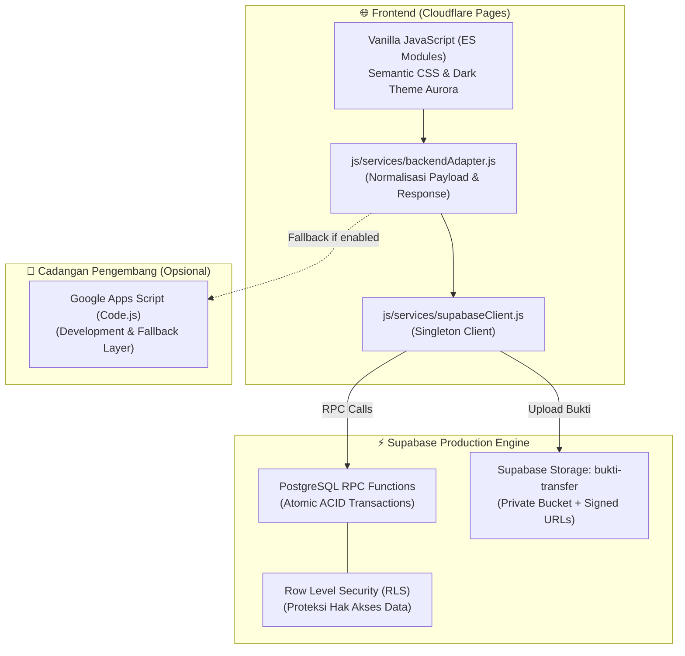

# 🤝 Donatur Helper

> **Patungan dan donasi bersama rekan tim, tanpa drama rekapan spreadsheet.**

[](https://don4tpro.pages.dev)
[](package.json)
[](supabase/)
[](tests/)

---

### 🌐 Akses Aplikasi Langsung
Aplikasi sudah aktif dan siap digunakan di tautan resmi produksi:  
👉 **[https://don4tpro.pages.dev](https://don4tpro.pages.dev)**

---

## 💡 Cerita di Balik Donatur Helper

Pernahkah Anda ditunjuk menjadi PIC untuk mengumpulkan patungan kado perpisahan rekan kerja, kado pernikahan, atau santunan duka cita di kantor?

Biasanya alurnya selalu sama:
- Mengumumkan nomor rekening di grup obrolan.
- Menerima puluhan tangkapan layar (screenshot) bukti transfer yang tercecer di berbagai ruang chat pribadi dan grup.
- Bolak-balik mengecek mutasi *m-banking* di sela-sela jam kerja yang padat.
- Merekap manual di spreadsheet yang rentan tertimpa data atau keliru rumus.
- Merasa canggung saat harus menagih siapa saja yang belum transfer menjelang tenggat waktu.

**Donatur Helper** dibangun untuk mengubah seluruh pengalaman tersebut. Semua proses—mulai dari pendaftaran donatur, perhitungan bagi rata tagihan (*bill split*), unggah bukti transfer, verifikasi oleh PIC, hingga pengembalian sisa dana (*refund*)—dikelola dalam satu sistem terpadu yang transparan, rapi, dan menenangkan bagi semua pihak.

---

## ✨ Fitur Sesuai Peran

### 🙋 Untuk Donatur (Anggota Tim)
* **Pilihan Nominal Fleksibel**: Ikut patungan dengan porsi sama rata (*open campaign*) atau berdonasi sukarela sesuai kemampuan (didukung nominal kustom minimal Rp 50.000).
* **Pembayaran Gabungan (*Combined Payment*)**: Punya dua atau lebih kewajiban donasi yang ditujukan ke rekening bank yang sama? Cukup lakukan **satu kali transfer** dan unggah **satu bukti transfer** untuk melunasi seluruhnya sekaligus.
* **Unggah Bukti Mudah & Aman**: Unggah bukti transfer langsung dari peramban ponsel atau laptop dengan aman.
* **Status Transparan**: Mengetahui dengan jelas posisi donasi Anda (*Menunggu Finalisasi*, *Menunggu Verifikasi*, *Perlu Diperbaiki*, atau *Lunas*).

### 📋 Untuk PIC (Penanggung Jawab Kampanye)
* **Buat & Kelola Kampanye**: Tentukan nama kampanye, batas waktu pembayaran (*deadline*), nomor rekening tujuan, serta target dana yang dibutuhkan.
* **Finalisasi Tagihan Otomatis**: Sistem otomatis membagi rata total belanja kado/kebutuhan kepada seluruh donatur yang sudah bergabung.
* **Antrean Verifikasi Terpusat**: Tinjau bukti transfer yang masuk dalam satu dasbor. Setujui bukti transfer dalam satu klik, atau tolak dengan menyertakan *Alasan Penolakan* yang jelas agar donatur dapat mengunggah bukti perbaikan.
* **Penyelesaian Refund**: Jika terdapat kelebihan transfer dari donatur, sistem mencatatnya sebagai *Refund perlu diselesaikan* hingga bukti pengembalian dicatat.

### 🛡️ Untuk Pengelola (Admin & SuperAdmin)
* **Verifikasi Anggota Baru**: Persetujuan terpusat untuk anggota tim yang baru mendaftar sebelum dapat mengakses kampanye.
* **Dasbor Berorientasi Batas Waktu (*Deadline-First*)**: Mengutamakan kampanye yang mendekati atau melewati tenggat waktu agar segera mendapat tindakan operasional.
* **Audit & Konfigurasi Global**: Pemantauan data menyeluruh, manajemen token akses, dan penyembunyian data rahasia (*secret masking*).

---

## 🏛️ Arsitektur & Teknologi

Donatur Helper dirancang dengan arsitektur *serverless* yang ringan, berkecepatan tinggi, dan berorientasi pada keandalan data transaksi.



* **Frontend**: Vanilla JavaScript murni berbasis modul ES6 (`js/views/`, `js/services/`, `js/config/`) dan CSS modern responsif tanpa framework berat. Menghasilkan waktu muat halaman yang instan.
* **Backend Database**: Supabase PostgreSQL dengan Stored Procedures / RPC untuk memastikan setiap mutasi data (pendaftaran, verifikasi, pembayaran) bersifat atomik dan aman dari *race conditions*.
* **Keamanan Dokumen**: Bukti transfer disimpan di *private bucket* Supabase Storage (`bukti-transfer`) dan hanya dapat diakses melalui URL bertanda tangan sementara (*pre-signed URLs*).
* **Infrastruktur Hosting**: Cloudflare Pages (`https://don4tpro.pages.dev`) untuk performa distribusi global ultra-cepat dengan sertifikat SSL otomatis.

---

## 🚀 Panduan Memulai di Komputer Lokal (*Local Development*)

### Prasyarat
* [Node.js](https://nodejs.org/) versi 18 atau lebih baru.
* Git.

### 1. Kloning Repositori
```bash
git clone https://github.com/itw-code/donatur-helper.git
cd donatur-helper
```

### 2. Pasang Dependensi
```bash
npm install
```

### 3. Konfigurasi Lingkungan (*Environment Variables*)
Salin berkas konfigurasi contoh ke berkas lokal:
```bash
# Untuk skrip backend / utilitas lokal
cp .env.example .env

# Untuk konfigurasi frontend browser
cp js/config/env.example.js js/config/env.local.js
```
Sesuaikan variabel pada `js/config/env.local.js` dengan kredensial publik Supabase Anda (`SUPABASE_URL` dan `SUPABASE_PUBLISHABLE_KEY`). Berkas ini telah diatur ke dalam `.gitignore` sehingga aman dari komit git.

### 4. Menjalankan Pengujian Otomatis
Seluruh fungsionalitas inti, adaptor backend, dan alur kerja diverifikasi melalui pengujian otomatis:
```bash
npm test
```

### 5. Membangun Aset Rilis Statis
Untuk membuat bundel statis di direktori `dist/` yang siap di-deploy ke Cloudflare Pages atau Netlify:
```bash
npm run build
```

---

## 📚 Panduan & Dokumentasi Pendukung

Untuk panduan lengkap mengenai tata cara operasional dan arsitektur detail sistem, silakan merujuk ke dokumen berikut:

* 📖 **[Panduan Pengguna & PIC](PANDUAN_USER_PIC.md)** — Tata cara lengkap pembuatan kampanye, penagihan, verifikasi bukti, dan pengelolaan donasi. (Tersedia juga versi cetak: `PANDUAN_USER_PIC.pdf`).
* ⚙️ **[Panduan Admin & Pengelola](PANDUAN_ADMIN.md)** — Prosedur persetujuan anggota, konfigurasi aplikasi, dan tata kelola akun. (Tersedia juga versi cetak: `PANDUAN_ADMIN.pdf`).
* 🏷️ **[Kamus Istilah & Domain Model](CONTEXT.md)** — Panduan bahasa baku dan aturan status transaksi (Kampanye, PIC, Bukti Transfer, Combined Payment, Refund).
* 📐 **[Desain Perubahan & Riwayat Tugas](docs/plans/)** — Catatan keputusan arsitektur dan riwayat pengembangan terstruktur.

---

## 🔒 Privasi & Keamanan

* **Zero Client Secrets**: Frontend peramban hanya menggunakan *Supabase Publishable/Anon Key* yang aman untuk publik. Kunci server, token rahasia, maupun kredensial basis data tidak pernah disertakan dalam kode sisi klien.
* **Row-Level Security (RLS)**: Hak akses baris data dikunci di tingkat database Postgres untuk mencegah manipulasi data dari luar wewenang.
* **Perlindungan Bukti Transfer**: Akses langsung ke berkas bukti transfer dinonaktifkan secara publik; peninjauan gambar bukti transfer wajib melalui token tanda tangan digital (*signed URL*).

---

<div align="center">
  <sub>Dikembangkan dengan penuh dedikasi untuk mendukung semangat gotong royong dan transparansi bersama.</sub><br/>
  <sub>© 2026 Donatur Helper Team.</sub>
</div>
